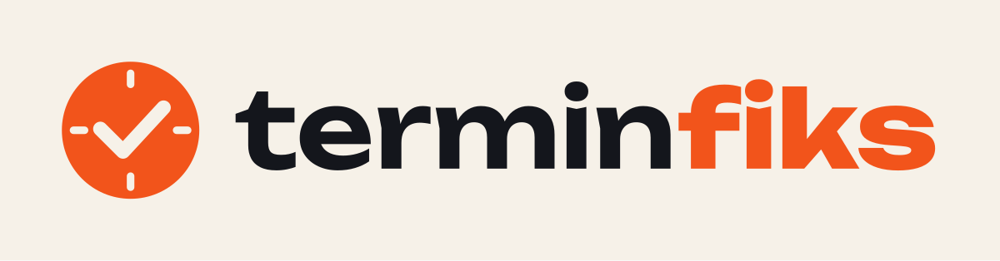

<p align="center">
  
</p>

# TerminFiks

**A booking link for barbers in Kosovo and North Macedonia. Customers book in 30 seconds without an app, and a WhatsApp reminder makes sure they actually show up.**

*Karrigia plot. Telefoni në heshtje.* (A full chair. A silent phone.)

## Start it (three commands)

Needs Node 20+ and the .NET 10 SDK.

```
git clone https://github.com/Zazalovers/terminfiks.git && cd terminfiks
npm install
npm run dev
```

- Landing page: http://localhost:5173
- Health check: http://localhost:5080/health → `{"status":"ok","database":"ok"}`
- Database: `backend/TerminFiks.Api/terminfiks.db` (created on first start with all tables; open it with any SQLite viewer)

## Status

Weekend 1: business, brand and rules. Weekend 2: project frame (landing page, back end with `/health`, data models and first migration). No features yet.

## Docs

| File | What's inside |
|---|---|
| [`docs/business.md`](docs/business.md) | 1. Problem + interviews · 2. Big picture · 3. Market and competitors · 4. Lean Canvas, price, costs, first 10 customers |
| [`docs/brand-book.md`](docs/brand-book.md) | Name checks, tagline, logo, colours, fonts, tone of voice |
| [`docs/brand/`](docs/brand/) | Logo files (SVG + PNG) and the one-page brand sheet |
| [`docs/rules-and-flows.md`](docs/rules-and-flows.md) | Roles, the 3 main flows, business rules, WhatsApp messages, what v1 will NOT do |
| [`docs/stack.md`](docs/stack.md) | Front end, back end, database, and why |
| [`docs/data-model.md`](docs/data-model.md) | Tables, links and the diagram |
