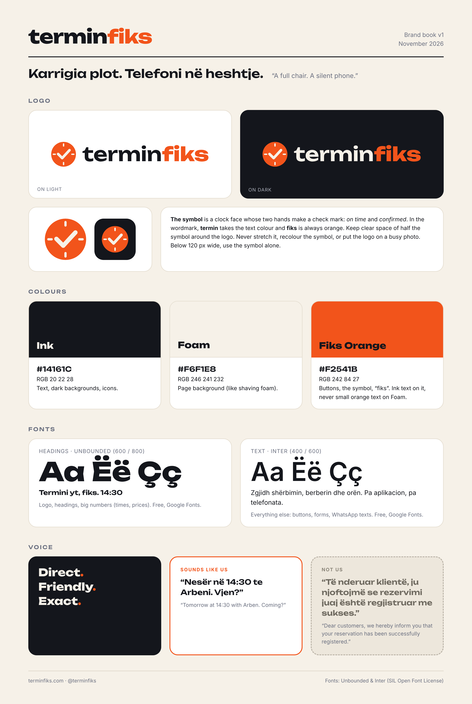
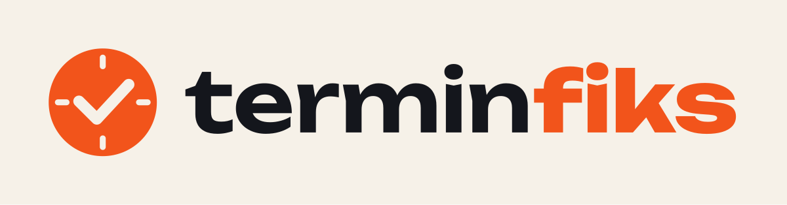
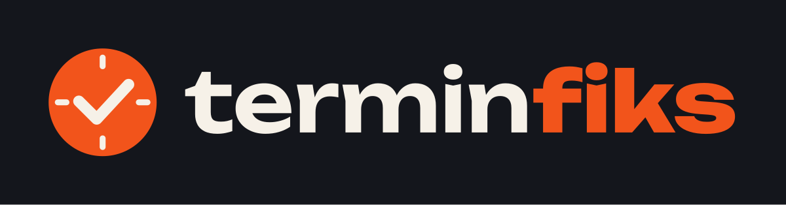

# TerminFiks · Brand book v1

*The one-page brand sheet above is `brand/brand-sheet.png`. Its source is `brand/brand-sheet.html`.*

---

## Name

**TerminFiks**, written in the logo as **termin**·**fiks**.

- **termin** means appointment. Albanians in Kosovo say it every day ("kam termin te berberi"), it's the same word in Macedonian (термин) and in German (Termin), so the diaspora gets it too.
- **fiks** is Albanian for *exactly, on the dot* ("në 14:30 fiks"), and it sounds like *fix* in German and English.
- Together: **an appointment that holds.** That is the whole promise against no-shows.

### Checks (13 November 2026)

| What | Result | How I checked |
|---|---|---|
| Domain **terminfiks.com** | Free | The .com registry lookup (RDAP, Verisign) answers "not found", so nobody has registered it |
| Domain **terminfiks.app** | Free | Same check at the .app registry (Google Registry RDAP) |
| Instagram **@terminfiks** | Free | instagram.com/terminfiks shows "Profile isn't available". A control check on an existing account showed a normal profile. |
| Instagram **@terminfiks.app** | Free | Same check |

> ⚠️ Free today doesn't mean free tomorrow. Register the domain (~$11 a year) and create the Instagram account before showing the name to anyone.

**Names I checked and dropped:**
- **Qethu** ("get a haircut!"): qethu.com and qethu.app are taken, and qethu.app is a competitor in Kosovo.
- **Ulu** ("sit down!"): ulu.com and ulu.app are taken.
- **Fiks** alone: fiks.com, fiks.app and getfiks.com are taken.

## Tagline

**Karrigia plot. Telefoni në heshtje.**
*A full chair. A silent phone.*

This one is for barbers, who pay. For customers, on the booking page, the line is **"Termini yt, fiks."** (*Your appointment, on the dot.*)

## Logo

| On light | On dark |
|---|---|
|  |  |

- **The symbol** is a clock face whose two hands form a check mark: *on time* and *confirmed*.
- **The wordmark:** "termin" takes the text colour (Ink on light, Foam on dark). "fiks" is always Fiks Orange.
- **Clear space:** keep at least half the symbol's width empty around the logo.
- **Small sizes:** below 120 px wide, use the symbol alone. Use the app icon for the Instagram profile picture and the favicon.
- **Don't:** stretch the logo, change the symbol's colours, put it on a busy photo, or add shadows and outlines.

### Files in `docs/brand/`

All SVGs are pure shapes, so you don't need the fonts installed to open them.

| File | Use |
|---|---|
| `terminfiks-logo-light.svg` / `.png` | Main logo for light backgrounds (transparent) |
| `terminfiks-logo-dark.svg` / `.png` | Main logo for dark backgrounds (transparent) |
| `terminfiks-logo-on-light.svg` / `.png` | Logo with Foam background (previews, documents) |
| `terminfiks-logo-on-dark.svg` / `.png` | Logo with Ink background |
| `terminfiks-symbol.svg` / `.png` | Symbol only (favicon, small spaces) |
| `terminfiks-wordmark-light.svg` / `-dark.svg` | Text only, for tight horizontal spaces |
| `terminfiks-app-icon.svg` / `.png` | Instagram profile picture, app icon (1080 × 1080) |
| `brand-sheet.png` / `.html` | The one-page brand sheet |

## Colours

| Name | Hex | RGB | Use it for |
|---|---|---|---|
| **Ink** | `#14161C` | 20 22 28 | Text, dark backgrounds, icons |
| **Foam** | `#F6F1E8` | 246 241 232 | Page background (like shaving foam), text on Ink |
| **Fiks Orange** | `#F2541B` | 242 84 27 | The symbol, "fiks" in the logo, main buttons |

**Contrast rules (WCAG):**
- Ink on Foam is 16.1 : 1, so it's fine for all text.
- Ink on Fiks Orange is 5.2 : 1, so buttons are orange with **Ink** text.
- Fiks Orange on Foam is only 3.1 : 1. Use it for big headings and shapes, **never for small text**.

## Fonts

Both are free on Google Fonts (SIL Open Font License). Both have the Albanian letters ë and ç, and Cyrillic for a later Macedonian version.

| Font | Weights | Use it for |
|---|---|---|
| **Unbounded** | 600, 800 | Logo, headings, big numbers (times, prices) |
| **Inter** | 400, 600 | Everything else: text, buttons, forms, WhatsApp messages |

## Tone of voice: Direct · Friendly · Exact

Like a good barber: few words, warm, and on time. We say "ti" (informal you), use short sentences, put the time first, and use at most one emoji.

| | Albanian | English |
|---|---|---|
| ✅ **Sounds like us** | "Nesër në 14:30 te Arbeni. Vjen?" | "Tomorrow at 14:30 with Arben. Coming?" |
| ❌ **Not us** | "Të nderuar klientë, ju njoftojmë se rezervimi juaj është regjistruar me sukses." | "Dear customers, we hereby inform you that your reservation has been successfully registered." |

More examples:

| Situation | ✅ Us | ❌ Not us |
|---|---|---|
| Booking done | "U bë! E premte, 17:00 te Arbeni." *(Done! Friday, 17:00 with Arben.)* | "Rezervimi juaj u procesua me sukses." *(Your reservation was processed successfully.)* |
| Slot taken | "Kjo orë sapo u zu. Provo 17:30?" *(That time was just taken. Try 17:30?)* | "Gabim 409: konflikt rezervimi." *(Error 409: booking conflict.)* |
| To the barber | "3 termine sot. I pari në 10:00." *(3 appointments today. The first is at 10:00.)* | "Ju keni 3 takime të planifikuara për datën e sotme." *(You have 3 meetings scheduled for today's date.)* |
