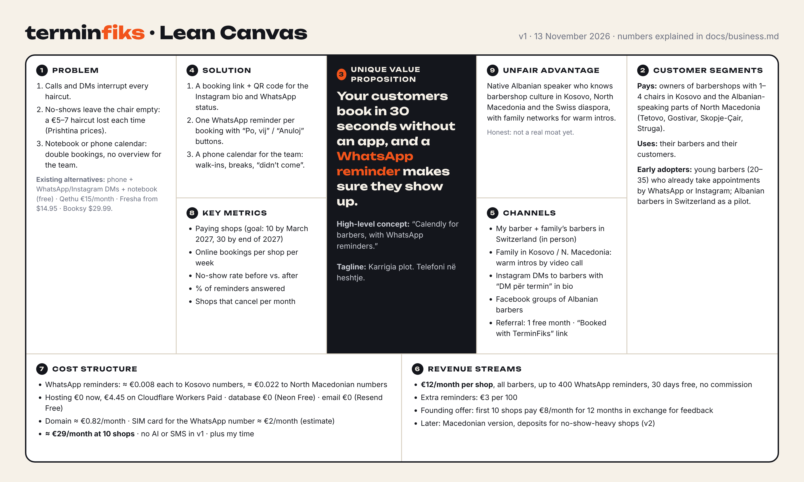

# TerminFiks · Business (parts 1–4)

> **TerminFiks gives barbers a booking link for Instagram and WhatsApp. Customers pick a time in 30 seconds without installing an app, and a WhatsApp reminder makes sure they actually show up.**

Version 1, 13 November 2026. Every number here has a source (listed at the end) or is marked **assumption**. Anything marked ⚠️ still has to be filled in before hand-in.

---

## 1. The problem

**Problem sentence:** Barbershop owners in Kosovo and North Macedonia lose money and focus every working day. While they cut, the phone rings and WhatsApp and Instagram messages pile up. And customers who booked often don't show up: every empty slot is a lost €5–7 haircut (Prishtina prices [1]) plus a stressful, chaotic day.

> ⚠️ After the interviews, put the real numbers into this sentence (calls per day, no-shows per week, price of a haircut).

### What real barbers told me, in their words

> ⚠️ **TODO before hand-in:** at least 2 real interviews. Only real quotes, written down exactly as they were said. First name + city only, and only with their permission.

**Person 1**
- Who: ⚠️ first name, barber in ___, ___ chairs, cutting for ___ years
- When and how: ⚠️ date, in person / WhatsApp call
- How customers book today: ⚠️
- Price of a haircut: ⚠️ €___
- No-shows per week (their estimate): ⚠️
- Which app their customers use most (WhatsApp, Viber, Instagram): ⚠️
- In their words:
  - ⚠️ "…"
  - ⚠️ "…"

**Person 2**
- Who: ⚠️ first name, barber in ___ (ideally Kosovo or North Macedonia), ___ chairs
- When and how: ⚠️
- How customers book today: ⚠️
- Price of a haircut: ⚠️ €___
- No-shows per week: ⚠️
- Which app their customers use most: ⚠️
- In their words:
  - ⚠️ "…"
  - ⚠️ "…"

**What I learned** (fill in after the interviews): ⚠️ What surprised me? What did they *not* care about? Did anything change my idea?

The questions I asked are in the appendix at the end of this file.

---

## 2. The big picture

**For a stranger, in one sentence:** TerminFiks is a booking link for barbers: customers pick a time without an app, and get a WhatsApp reminder so they don't forget.

| | |
|---|---|
| **Who uses it** | Barbers (the owner and his team) every day on their phone. Their customers, only when they book or cancel. |
| **Who pays** | The shop owner, monthly. Customers never pay anything. |
| **Why now** | 1. **Fresha stopped being free.** It moved from a mostly free model to paid plans in 2025/26 [3], so price-sensitive barbers are looking around. 2. **WhatsApp went per-message.** Since July 2025 Meta charges per message, and one reminder to a Kosovo number costs under 1 cent [11][12]. That makes a cheap local price possible. 3. **Kosovo barbers are starting to book online.** Qethu is a new app made only for Kosovo barbers [2] (its domains were registered in 2025), but it doesn't mention no-shows or WhatsApp, and it isn't in North Macedonia. 4. **Diaspora peaks.** About 550,000 Kosovars live abroad [8], and many come home in summer and for holidays. **Assumption:** those are the weeks when no-shows hurt most (check in interviews). |

### Four ways to solve the same problem

| Way | How it would work | Why I didn't pick it (for now) |
|---|---|---|
| **Service:** booking assistant | One person answers WhatsApp and the phone for 5–10 shops and books for them | Someone has to be online all day. It costs more per shop than software and doesn't scale. |
| **Marketplace app** | A customer app that lists all barbers, like Fresha or Qethu | It needs thousands of customers *and* shops at the same time (chicken and egg), and Qethu already does it in Kosovo. |
| **WhatsApp chatbot** | The customer writes *"a ke termin nesër në 5?"* and a bot answers | Since 1 October 2026 Meta charges for replies after 1,000 free a month per number [11]. Bots also misunderstand, and it's hard to build well. |
| **Physical product** | QR stand at the mirror + a tablet showing "next in line" | Hardware costs money, can break or get stolen, and doesn't stop no-shows. |

**My choice: a booking link + exactly one WhatsApp reminder per booking.**
- Customers already tap links in Instagram bios, so nobody has to download an app.
- A barber understands it in a one-minute demo on my phone.
- One message per booking keeps the cost under €0.01 in Kosovo.
- I can build it and sell it alone.
- It's useful from the first shop. A marketplace only works once it has many.

---

## 3. The market

### Competitors

| Competitor | Price | What it does well | Where it fails | Link |
|---|---|---|---|---|
| **Qethu** (Kosovo) | €15/month per shop incl. team, 30 days free, no commission [2] | Albanian, made for Kosovo barbers, one simple flat price, booking in app or browser | Kosovo only. Its site doesn't mention reminders or no-shows. Customers "request" a time that the barber then manages. | [qethu.app](https://qethu.app) |
| **Fresha** (international) | Independent $19.95/month, Team $14.95 per bookable member/month, no free plan anymore [3] | Polished app and a big marketplace, already used by some shops in Prishtina [1] and Skopje [19] | Takes a 20% commission on new clients from its marketplace [3]. Priced for Western Europe. A general beauty tool, heavy for a one-chair barber. | [fresha.com](https://www.fresha.com) |
| **Booksy** (international) | $29.99/month + $20 per extra team member (US price) [4] | Built for barbers, has a marketplace, reminders included | The most expensive option: about 5 Kosovo haircuts a month. Built for US and Western markets. | [booksy.com](https://booksy.com) |
| **Cutlio** (Croatia, regional) | Not published | Builds a branded app for each barbershop across ex-Yugoslavia, including Macedonian-language apps [5] | Customers must install a separate app for every shop. No Albanian. | [example app](https://apps.apple.com/kn/app/hairdo/id6502281942) |
| **Glowsel** (Albania) | Business price not published | Albanian beauty marketplace with reminders and reviews [6] | Focused on Albania and beauty salons, not barbers in Kosovo or North Macedonia. Customers need the app. | [App Store](https://apps.apple.com/bf/app/glowsel/id6744941893) |
| **Do nothing:** phone + WhatsApp/Instagram DMs + notebook | €0 | Free, personal, everyone already knows it | Interrupts every haircut, no reminders so more no-shows, double bookings, no overview for the team | — |

Qethu, Cutlio and Glowsel came out of the Claude research step. I hadn't heard of them before.

### How many possible customers are there in Kosovo and North Macedonia?

| Step | Number | How I got it |
|---|---|---|
| 1. Active hair & beauty businesses in **Kosovo** | **5,673** | Kosovo business register (ARBK), activity code 96.02, shown on an independent site [7]. 9,077 were ever registered; 5,673 are still active. |
| 2. Hair & beauty businesses per 1,000 people (Kosovo) | **3.54** | 5,673 ÷ 1,602,515 people (2024 census [8]) × 1,000 |
| 3. Hair & beauty businesses in **North Macedonia** | **≈ 6,500** | No public count found, so **assumption:** same density as Kosovo. 1,836,713 people (2021 census [10]) × 3.54 ÷ 1,000 = 6,502 |
| 4. All hair & beauty, both countries (biggest possible market) | **≈ 12,200** | 5,673 + 6,502 |
| 5. Of these, **barbershops** | **≈ 4,060** | **Assumption:** 1 in 3 is a men's barber (the rest are women's salons, nails, cosmetics). Kosovo 1,891, North Macedonia 2,167. Check by counting on Google Maps in one city. |
| 6. Barbershops I can serve with v1 (Albanian language) | **≈ 2,240** | Kosovo 1,891 × 90.8% Albanian [9] = 1,717, plus North Macedonia 2,167 × 24.3% Albanian [10] = 527 |
| 7. Goal for year 1 | **30 shops** | 1.3% of step 6, which is €360/month at €12 per shop |

At €12/month, all ~4,060 barbershops would be worth about €584,000 a year. The Albanian-speaking ~2,240 would be worth about €323,000 a year.

### Why a customer would choose TerminFiks

**It is the cheapest way for an Albanian-speaking barber to stop no-shows: €12 a month, nothing to install for customers, and a WhatsApp reminder with a Cancel button for every booking.**

---

## 4. Business model and price

### Lean Canvas

| Box | Content |
|---|---|
| **1. Problem** | Calls and DMs interrupt every haircut · no-shows empty the chair · notebook means double bookings. *Existing alternatives:* phone/DMs + notebook, Qethu, Fresha, Booksy. |
| **2. Customer segments** | Owners of barbershops with 1–4 chairs in Kosovo and the Albanian-speaking parts of North Macedonia (Tetovo, Gostivar, Skopje-Çair, Struga). *Early adopters:* young barbers (20–35) who already take appointments on WhatsApp or Instagram, plus Albanian barbers in Switzerland as a pilot. |
| **3. Unique value proposition** | "Your customers book in 30 seconds without an app, and a WhatsApp reminder makes sure they show up." *High-level concept:* Calendly for barbers, with WhatsApp reminders. |
| **4. Solution** | A booking link + QR code · one WhatsApp reminder with "Po, vij" / "Anuloj" buttons · a phone calendar for the team (walk-ins, breaks, no-shows) |
| **5. Channels** | See "How the first 10 customers will find me" below |
| **6. Revenue streams** | €12/month per shop · extra reminder packs · later: Macedonian version, deposits |
| **7. Cost structure** | WhatsApp messages, hosting, domain, SIM card, my time (table below) |
| **8. Key metrics** | Paying shops · online bookings per shop per week · no-show rate before vs. after · % of reminders answered · shops that cancel per month |
| **9. Unfair advantage** | I'm a native Albanian speaker who knows barbershop culture in Kosovo, North Macedonia and the Swiss diaspora, with family networks for warm intros. Honestly, that isn't a real moat yet. |

### Price: €12 per month per shop

- **What's included:** all barbers in the shop, unlimited bookings, up to **400 WhatsApp reminders a month** (enough for 2–3 busy chairs), no commission.
- **Extras:** more reminders cost €3 per 100. The first 30 days are free.
- **Founding offer (my decision to make):** the first 10 shops pay €8/month for 12 months, in exchange for honest feedback and a short video review.

**Why monthly** and not per booking or one-off: barbers already think in monthly costs like rent and electricity, and a fixed price is easy to say yes to. A fee per booking would punish my busiest customers. A one-off price can't pay for WhatsApp messages, which cost money every month.

**Why €12:**
1. It's below every real competitor: Qethu €15 [2], Fresha from $14.95 per member [3], Booksy $29.99 [4].
2. It pays for itself if it saves about **2–3 no-shows a month** at a €5 haircut [1] (12 ÷ 5 = 2.4).
3. It covers the WhatsApp cost even at the 400-reminder limit:

| Reminders a month | Kosovo numbers | North Macedonian numbers |
|---|---|---|
| 200 | €1.58 | €4.34 |
| 400 | €3.15 | €8.68 |

At €12, North Macedonia still leaves a margin, but a thin one, so I start in Kosovo.

### Monthly costs (example: 10 shops, 8 in Kosovo and 2 in North Macedonia, 200 reminders each)

| Cost | Per month | Source / note |
|---|---|---|
| WhatsApp reminders | **€21.30** | Utility message to a Kosovo number $0.00886 (Meta "Other" rate), to a North Macedonian number $0.02438 ("Rest of Central & Eastern Europe") [11][12]. 1 USD = €0.89 [18] |
| Hosting (Cloudflare Workers) | €0 → €4.45 | Free plan: 100,000 requests a day. Paid: $5/month [14] |
| Database (Neon Postgres) | €0 | Free plan, 1 GB per project [15] |
| Email (Resend) | €0 | Free plan, 3,000 emails a month (max 100 a day) [16] |
| Domain terminfiks.com | €0.82 | $11.08 a year at Porkbun [17] |
| SIM card for the WhatsApp Business number | ≈ €2 | **Estimate**, prepaid SIM |
| SMS | €0 | Not used in v1 |
| AI | €0 | No AI features in v1 |
| **Total** | **≈ €24–29** | Revenue at 10 shops: €120 (or €80 with the founding offer) |

Collecting money: card billing needs a registered business or an adult account holder, so v1 collects the subscription manually (bank transfer). Automatic card billing comes later.

### How the first 10 customers will find me

| Channel | How exactly | Expected shops |
|---|---|---|
| **My own network in Switzerland** | My barber and the barbers my family goes to. I show them in person; they get a free pilot. | 2 |
| **Family in Kosovo / North Macedonia** | Relatives introduce me to their barbers, and I demo by video call | 3 |
| **Instagram DMs** | Barbers in Prishtina, Prizren, Ferizaj and Tetovo who write "DM për termin" in their bio. I send a 30-second screen recording. | 3 |
| **Facebook groups for Albanian barbers** | A post with the demo video + the founding offer | 1 |
| **Referral + "Booked with TerminFiks" link** | Every shop that brings another shop gets 1 month free. Every booking page has a small link back. | 1 |
| **Total** | **Goal: 10 paying shops by end of March 2027** | **10** |

### Biggest risks (what Claude attacked) and how I'll check them

| Risk | Why it matters | How I check or fix it |
|---|---|---|
| **Customers use Viber, not WhatsApp** | Viber is very popular in Kosovo [13] and North Macedonia (with Messenger) [13]. If customers don't use WhatsApp, reminders don't arrive. | Ask in every interview. Keep the reminder channel separate in the code so Viber can be added in v2. The diaspora uses WhatsApp a lot. |
| **Qethu already exists** | Same country, same idea, €15 | Be clearly better at one thing (no-shows), cheaper, and also in North Macedonia |
| **Many barbers work walk-in only** | Then online booking isn't needed | Target barbers who already take appointments by phone or DM. Walk-ins stay possible. |
| **WhatsApp costs can change** | Since 1 Oct 2026 replies and in-window messages are charged too [11] | Max 1 reminder per booking + 1 cancellation message. Price includes a reminder limit. |
| **Selling from Switzerland** | Hard to visit shops in Kosovo or North Macedonia | Pilot shops in Switzerland first, warm intros through family, and visits during holidays |

---

## Appendix: interview questions

Ask about what *already happened*, not "would you buy this?". Write down the exact words.

1. How do customers book with you today: phone, WhatsApp, Instagram, or do they just walk in? / *Si i rezervojnë klientët terminet te ti sot: me telefon, WhatsApp, Instagram, apo vijnë direkt?*
2. How often does someone call or message while you're cutting? / *Sa herë në ditë të thërrasin ose të shkruajnë klientët ndërsa je duke qethur?*
3. Tell me about the last time a customer didn't come. What happened? / *Më trego për herën e fundit kur një klient nuk erdhi në termin. Çfarë ndodhi?*
4. Roughly how many customers don't come per week? / *Sa klientë nuk vijnë në javë, përafërsisht?*
5. Where do you write appointments down: notebook, phone calendar, an app? / *Ku i shënon terminet: në fletore, në kalendarin e telefonit, apo në ndonjë aplikacion?*
6. Have you ever tried a booking app? Which one, and why did you stop? / *A ke provuar ndonjëherë ndonjë aplikacion për rezervime? Cilin, dhe pse e ke lënë?*
7. What would worry you if customers booked online by themselves? / *Çfarë do të të shqetësonte nëse klientët rezervojnë vetë online?*
8. How much do you pay per month for apps, software or ads today? / *Sa paguan tani në muaj për aplikacione, softuer apo reklama?*
9. How much is a haircut with you? / *Sa kushton një qethje te ti?*
10. Do your customers use WhatsApp or Viber more? / *Klientët e tu përdorin më shumë WhatsApp apo Viber?*
11. Can I show you a first version in a few weeks? / *A mund të të tregoj një version të parë pas disa javësh?*

---

## Sources

1. Fresha listing, Barber Shop Labi, Prishtina (haircut €5, haircut + wash + styling €7): https://www.fresha.com/a/barber-shop-labi-prishtina-pristina-banesat-e-arabve-aqz7cu7q
2. Qethu website, read 13 Nov 2026 (€15/month per shop incl. team, 30 days free, no commission, "for the barbers of Kosovo"): https://qethu.app
3. Fresha prices and model: https://www.softwares.com/software/fresha/pricing · commission: https://costbench.com/software/salon-spa/fresha/ · move to paid plans: https://www.costbench.com/software/salon-spa/fresha/hidden-costs/
4. Booksy pricing: https://koalendar.com/blog/booksy-pricing
5. Cutlio app for a North Macedonian barbershop (Macedonian text): https://apps.apple.com/kn/app/hairdo/id6502281942
6. Glowsel: https://apps.apple.com/bf/app/glowsel/id6744941893
7. Kosovo business register data, activity 96.02 (independent site using ARBK data): https://arbk.atlas-studio.eu/sq/activity/9602
8. Kosovo census 2024 (1,602,515 residents, ~550,000 in the diaspora): https://prishtinainsight.com/headcount-results-show-kosovo-faces-declining-population-and-rising-urbanization/
9. Kosovo census 2024, ethnic composition (90.79% Albanian): https://kryeministri.rks-gov.net/en/blog/the-first-final-results-from-the-census-of-population-households-and-housing-in-kosovo-are-presented/
10. North Macedonia census 2021 (1,836,713 residents, 24.3% Albanian): https://civil.today/?p=37453
11. Meta, pricing on the WhatsApp Business Platform (Kosovo maps to "Other", North Macedonia to "Rest of Central & Eastern Europe", changes from 1 Oct 2026): https://developers.facebook.com/docs/whatsapp/pricing
12. WhatsApp per-message rates by market: https://help.sleekflow.io/en_US/daftar-harga
13. Viber in Kosovo: https://periskopi.com/en/2022/1/viber-dominates-kosovos-app · North Macedonia: https://telegrafi.com/qytetaret-e-maqedonise-ne-celular-shume-perdorin-viber-dhe-facebook-messenger/
14. Cloudflare Workers pricing: https://developers.cloudflare.com/workers/platform/pricing/
15. Neon Free plan: https://neon.com/faqs/free-plan-limits-and-quotas
16. Resend pricing: https://www.usecarly.com/blog/resend-pricing/
17. Porkbun .com price: https://domainoffer.net/tld/com/porkbun
18. EUR/USD rate, 9 Nov 2026: https://www.exchange-rates.org/converter/eur-usd
19. Fresha listing in Skopje: https://fresha.com/a/fabulash-by-flora-skopje-kemal-ataturk-gfwm377i
