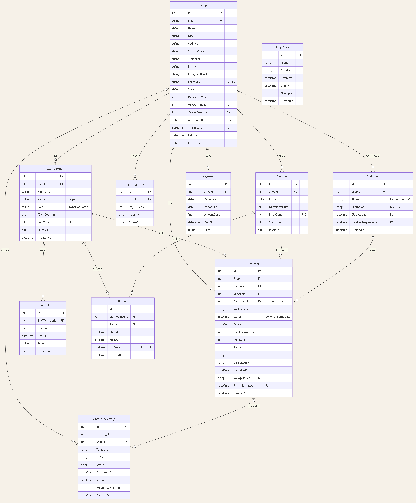

# TerminFiks · Data model (v1)

The things TerminFiks stores, taken from the roles, flows and rules R1–R15 in [`rules-and-flows.md`](rules-and-flows.md). The C# models are in `backend/TerminFiks.Api/Models/`, the table setup in `backend/TerminFiks.Api/Data/AppDbContext.cs`, and the first migration is `backend/TerminFiks.Api/Migrations/*_InitialCreate.cs`.



*Picture source: [`diagrams/data-model.mmd`](diagrams/data-model.mmd) (Mermaid). To redraw: `npx @mermaid-js/mermaid-cli -i docs/diagrams/data-model.mmd -o docs/data-model.png -b "#F6F1E8" -s 2 -w 1800`. The DBML below pastes straight into dbdiagram.io.*

## Tables

| Table | What it is | Links | Rules |
|---|---|---|---|
| **Shops** | One barbershop, one location. Its link is `terminfiks.com/{Slug}`. | Has everything below | R1, R3 (settings per shop), R11, R12, R14 |
| **StaffMembers** | The owner and the barbers. Log in with their WhatsApp number. | Shop 1 → n | R15 (`SortOrder` for "Kushdo") |
| **Services** | "Qethje 20 min €5" etc. | Shop 1 → n | R10 (price is info only) |
| **OpeningHours** | Open intervals per weekday. Two rows on one day = a break. | Shop 1 → n | R14 (local time) |
| **TimeBlocks** | A barber's break or day off. | StaffMember 1 → n | |
| **Customers** | A customer of **one** shop, found by phone. No account. | Shop 1 → n | R6 (`BlockedUntil`), R8, R13 |
| **Bookings** | One appointment. | Shop, StaffMember, Service, Customer (null for a walk-in) | R2, R3, R4, R5, R6, R9 |
| **SlotHolds** | A time held for 5 minutes while the form is open. | StaffMember, Service | R2 |
| **WhatsAppMessages** | Every message sent or planned. | Booking (null for login codes), Shop | R4 (max 2 per booking), R11 (400 a month) |
| **LoginCodes** | 6-digit login codes for owners and barbers (hashed). | none | |
| **Payments** | Subscription payments, recorded by the admin. | Shop 1 → n | R11 |

## Decisions

- **Times** are stored in UTC and shown in the shop's `TimeZone` (R14). Opening hours are local `TimeOnly`, because "09:00" means 09:00 in the shop all year round.
- **Money** is integer euro cents (`PriceCents`, `AmountCents`): no rounding errors.
- **Enums** (status, role, source, template) are stored as text so the SQLite file is easy to read.
- **No double bookings (R2):** a unique index on `Bookings (StaffMemberId, StartsAt)` that skips cancelled bookings. Overlaps of different lengths will be checked in code when booking is built.
- **Customers per shop (R13):** the same phone number at two shops is two rows, because the data belongs to each shop. Blocks after no-shows (R6) are per shop too.
- **Price and duration are copied** into the booking, so changing a service later doesn't change past bookings.
- **Deleting a customer (R13)** keeps their bookings for the barber's history, with the customer link set to null.
- **Photos** are not stored in SQLite; `Shop.PhotoKey` will point to the file in S3.
- **Admins** have no table in v1; they'll be a list of phone numbers in config.

## Open question

Flow 1 lists durations 15/20/30/45/60 min, but the suggested "Mjekër" (beard) service is 10 min. `DurationMinutes` is a plain number for now. Which is right?

## DBML (for dbdiagram.io)

```dbml
Table Shops {
  Id int [pk, increment]
  Slug varchar(60) [unique, not null]
  Name varchar(80) [not null]
  City varchar(60) [not null]
  Address varchar(160) [not null]
  CountryCode varchar(2) [not null, note: 'XK, MK, CH']
  TimeZone varchar(40) [not null, note: 'R14']
  Phone varchar(16) [not null]
  InstagramHandle varchar(30)
  PhotoKey varchar(200) [note: 'S3 object key']
  Status varchar(30) [not null, note: 'Draft, PendingApproval, Active, Paused']
  MinNoticeMinutes int [not null, default: 30, note: 'R1']
  MaxDaysAhead int [not null, default: 14, note: 'R1']
  CancelDeadlineHours int [not null, default: 2, note: 'R3']
  ApprovedAt datetime [note: 'R12']
  TrialEndsAt datetime [note: 'R11']
  PaidUntil datetime [note: 'R11']
  CreatedAt datetime [not null]
}

Table StaffMembers {
  Id int [pk, increment]
  ShopId int [not null, ref: > Shops.Id]
  FirstName varchar(40) [not null]
  Phone varchar(16) [not null]
  Role varchar(30) [not null, note: 'Owner, Barber']
  TakesBookings bool [not null]
  SortOrder int [not null, note: 'R15']
  IsActive bool [not null]
  CreatedAt datetime [not null]
  indexes { (ShopId, Phone) [unique] }
}

Table Services {
  Id int [pk, increment]
  ShopId int [not null, ref: > Shops.Id]
  Name varchar(60) [not null]
  DurationMinutes int [not null]
  PriceCents int [not null, note: 'R10']
  SortOrder int [not null]
  IsActive bool [not null]
}

Table OpeningHours {
  Id int [pk, increment]
  ShopId int [not null, ref: > Shops.Id]
  DayOfWeek int [not null]
  OpensAt time [not null]
  ClosesAt time [not null]
}

Table TimeBlocks {
  Id int [pk, increment]
  StaffMemberId int [not null, ref: > StaffMembers.Id]
  StartsAt datetime [not null]
  EndsAt datetime [not null]
  Reason varchar(80)
  CreatedAt datetime [not null]
}

Table Customers {
  Id int [pk, increment]
  ShopId int [not null, ref: > Shops.Id]
  Phone varchar(16) [not null]
  FirstName varchar(40) [not null, note: 'R8']
  BlockedUntil datetime [note: 'R6']
  DeletionRequestedAt datetime [note: 'R13']
  CreatedAt datetime [not null]
  indexes { (ShopId, Phone) [unique] }
}

Table Bookings {
  Id int [pk, increment]
  ShopId int [not null, ref: > Shops.Id]
  StaffMemberId int [not null, ref: > StaffMembers.Id]
  ServiceId int [not null, ref: > Services.Id]
  CustomerId int [ref: > Customers.Id, note: 'null for walk-in']
  WalkInName varchar(40)
  StartsAt datetime [not null]
  EndsAt datetime [not null]
  DurationMinutes int [not null]
  PriceCents int [not null]
  Status varchar(30) [not null, note: 'Booked, Confirmed, Cancelled, Came, NoShow']
  Source varchar(30) [not null, note: 'Online, WalkIn, Phone']
  CancelledBy varchar(30)
  CancelledAt datetime
  ManageToken varchar(64) [unique, not null]
  ReminderDueAt datetime [note: 'R4']
  CreatedAt datetime [not null]
  indexes { (StaffMemberId, StartsAt) [unique, note: 'where Status <> Cancelled (R2)'] }
}

Table SlotHolds {
  Id int [pk, increment]
  StaffMemberId int [not null, ref: > StaffMembers.Id]
  ServiceId int [not null, ref: > Services.Id]
  StartsAt datetime [not null]
  EndsAt datetime [not null]
  ExpiresAt datetime [not null, note: 'R2: +5 min']
  CreatedAt datetime [not null]
}

Table WhatsAppMessages {
  Id int [pk, increment]
  BookingId int [ref: > Bookings.Id]
  ShopId int [ref: > Shops.Id]
  Template varchar(30) [not null, note: 'Reminder, CancelledByCustomer, CancelledByShop, LoginCode']
  ToPhone varchar(16) [not null]
  Status varchar(30) [not null]
  ScheduledFor datetime [not null]
  SentAt datetime
  ProviderMessageId varchar(100)
  CreatedAt datetime [not null]
}

Table LoginCodes {
  Id int [pk, increment]
  Phone varchar(16) [not null]
  CodeHash varchar(128) [not null]
  ExpiresAt datetime [not null]
  UsedAt datetime
  Attempts int [not null]
  CreatedAt datetime [not null]
}

Table Payments {
  Id int [pk, increment]
  ShopId int [not null, ref: > Shops.Id]
  PeriodStart date [not null]
  PeriodEnd date [not null]
  AmountCents int [not null]
  PaidAt datetime [not null]
  Note varchar(200)
}
```
